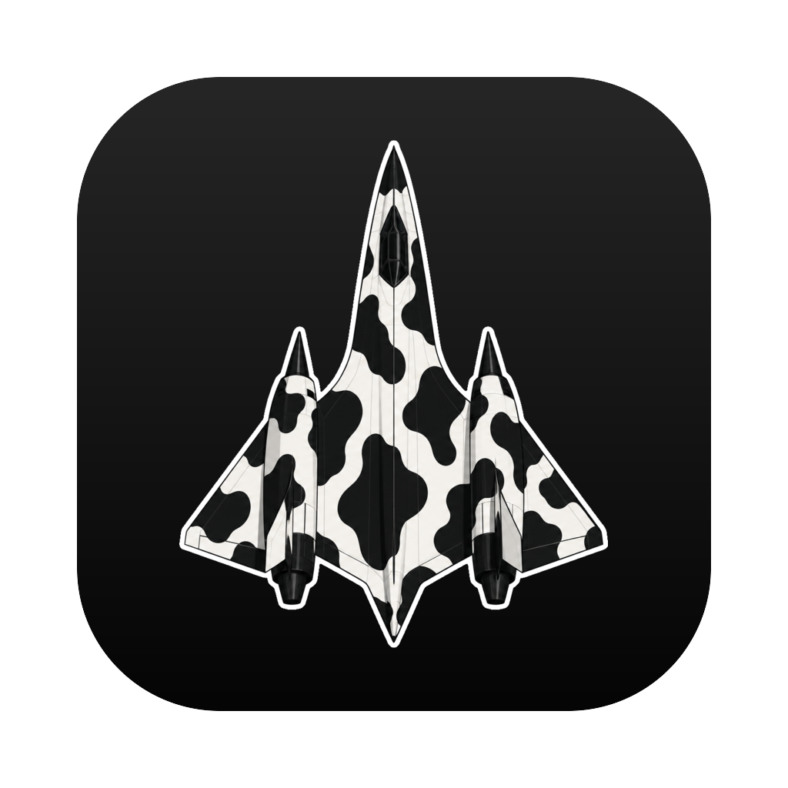

<p align="center">
  
</p>

<h1 align="center">Rudder</h1>

A macOS fzf-style app switcher. Hit **⌥Space**, type, **Enter**. The panel
appears instantly over everything, filters running apps (and their windows,
and installed apps that aren't running) as you type, and brings the selection
to the front behind it while you type. **⌥`** jumps back to where you were
before, and keeps walking back on each press.

Drawn with eacp's GPU component tier (one `ComponentHost`), no web view.

## Build and run

```sh
just build   # configure + build (CMake/Ninja, deps via CPM)
just run     # build, quit any running Rudder, reset its dev Accessibility grant, open it
just test    # unit tests
```

Rudder is an agent app: no Dock icon, a menu-bar icon (Open, Settings…, Quit),
and it registers itself to start at login.

## Permissions

Accessibility, for the live preview, window rows and the keyboard while the
panel is up. Without it the panel shows an unlock overlay: drag the Rudder
icon into System Settings › Privacy & Security › Accessibility and switch it
on. Every dev build is ad-hoc signed with a new cdhash, so `just run` resets
the grant first.

## Keys

| | |
|---|---|
| ⌥Space | open / close the panel (rebindable) |
| ⌥\` | go back (rebindable) |
| ↑ ↓, ⌃N ⌃P | move |
| Enter | switch (launches a closed app, focuses a window row) |
| Esc | close and put the screen back |
| ⌃Q | quit the selected app (rebindable) |
| ⌘D | favourite / unfavourite the selection (rebindable) |
| ⌃W ⌃U ⌃K ⌃A ⌃E ⌃B ⌃F ⌃H ⌃D, ⌥B ⌥F ⌥⌫ | readline editing |

## Favourites

Starred rows at the top of the panel, always searchable. They live in
`~/.config/rudder.json` (also shown in Settings), which Rudder reloads
whenever it changes on disk:

```json
{
  "favourites": [
    {"title": "tamber-web PRs", "url": "https://github.com/tamber-inc/tamber-web/pulls",
     "keywords": ["prs", "pulls"]},
    {"title": "Notes", "app": "com.apple.Notes"},
    {"title": "Projects", "path": "~/projects"}
  ]
}
```

Each needs a `title` and one of `url`, `app` (bundle id) or `path`; `openWith`
(bundle id) picks the app a url opens in. A url that's already open in a
provider's tab (Grazer) switches to that tab instead of opening another.

## Icons

`Assets/Icon/Source.png` is the art; `Scripts/make-icons.sh` (ImageMagick 7)
turns it into the macOS app icon (`Icon.png`, Apple's 824-on-1024 grid), the
Windows `Icon.ico` (near full-bleed tile, plain silhouette at 16–48 px) and the
tray glyphs (`Tray.png` template for the menu bar, `TrayWindows.png`). The
outputs are committed; rerun the script only when the art changes.

## Debugging

- `RUDDER_LOG=1` traces the show/hide handshake, previews, the back stack and
  latency (hotkey → first frame, key → frame) on stderr.
- `Rudder --snapshot <dir>` renders the panel and the unlock overlay to PNGs.

## Publishing contexts from an app

Apps can list their own places (tabs, sessions) in Rudder. Rudder listens on
`~/Library/Application Support/Rudder/rudder.sock` for newline-delimited JSON
(see `Client/RudderProtocol.h`) and posts the distributed notification
`rudder.started` when it starts. The `RudderClient` library does the client
side; pull in just that with CPM:

```cmake
CPMAddPackage(NAME Rudder GIT_REPOSITORY <rudder repo> GIT_TAG main
              OPTIONS "RUDDER_CLIENT_ONLY ON")
target_link_libraries(MyApp PRIVATE RudderClient)
```

```cpp
auto rudder = rudder::RudderClient {{"MyApp", "com.example.myapp"}};
rudder.onActivate = [](const std::string& id) { /* bring that place forward */ };
rudder.pushContexts({{"1", "Title", "subtitle", "https://..."}});
```

It reconnects when Rudder restarts and is silent when Rudder isn't running.
Grazer is the first provider.
